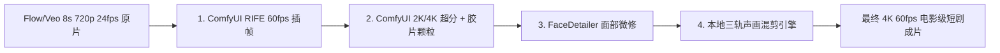

# Google Flow / Veo 视频自动化生片、一致性锁定与 100 积分风控体系方案

> **归档日期**：2026年10月10日  
> **项目代号**：北宋杨家将 · 云端 Veo 与本地 ComfyUI 工业级影视短剧制作体系  
> **硬件与执行环境**：Windows 11, NVIDIA GeForce RTX 4060 Ti (16GB VRAM), Google Flow (CDP: 127.0.0.1:9222)  

---

## 一、核心问题复盘与机制释疑

### 1. 为什么此前控制 Google Flow 只有图片、没有视频？
* **根本原因**：Google Flow 工作台底部提示词输入框默认激活的模型为 **`🍌 Nano Banana 2.1`（图片生成模型）**，并发生成 2 张图片（`x2` 档位）。
* **自动化脚本缺陷**：此前的测试脚本仅聚焦输入框并填入提示词，随后直接点击了提交箭头（`Start generation`），**未在提交前唤起设置面板将模式切换至 `[📹 Video]` 视频模型（如 Veo 3.1 - Lite / Fast）**，因此系统默认执行了 Nano Banana 的生图操作。
* **产物表现**：生成的全为 16:9 / 1:1 的静态图片（存储于 `flow.google.com/asb/` 资源池），未产生任何视频。

### 2. 为什么昨日的“免费 50 积分”没有被扣除/使用？
* **积分扣除机制差异**：
  * **视频模型**：Veo 3.1（Lite 10 积分/次、Fast 20 积分/次、Quality 100 积分/次）需要消耗 Google Flow 算力积分；
  * **图像模型**：Nano Banana 2.1 静态图像生成界面明确标注 **`Generating will use 0 credits`**（0 积分消耗），享受独立的配额。
* **零扣费与过期重置**：
  * 账户余额保持为 **1,050 积分**（Pro 订阅 1,000 积分 + 当日赠送 50 积分）；
  * 每日 50 免费积分规则为**“当日有效、不跨天累计、次日自动刷新”**，因昨天未发起视频任务，50 点当日配额自然随日期间隔重置刷新。

---

## 二、Google Flow 四大一致性锁定机制（人物 / 场景 / 风格）

```mermaid
flowchart TD
    subgraph S1[1. 人物一致性锁]
        C[Characters 角色资产库] --> C_Ref[多视角定妆照 / 绑脸特征]
        C_Ref --> IngC[作为 Character Ingredient 注入]
    end

    subgraph S2[2. 场景一致性锁]
        S[Scenes 场景资产库] --> S_Ref[开封宫殿 / 五台山雪景空间定义]
        S_Ref --> IngS[作为 Scene Ingredient 注入]
    end

    subgraph S3[3. 风格一致性锁]
        A[Agent 画风守则] + P[风格锚点词 Style Tokens] --> Prompt[上海美影厂工笔水墨剪纸风格]
    end

    subgraph S4[4. 动作连贯性锁]
        Grid[首帧切片 / Nano Banana 分镜] --> Frames[Frames 首帧驱动 Image-to-Video]
    end

    IngC & IngS & Prompt & Frames --> Veo[Veo 3.1 视频渲染]
    Veo --> Video[人物不漂移、光影统一、连贯成片]
```

1. **人物一致性锁（Characters Profile）**：
   在左侧侧边栏 `Characters` 库建立宋太宗、寇准、杨延平等核心角色档案，注入正/侧面多视角参考图。通过 `@Character` 或 `[+] Ingredients` 挂载，利用模型的 Cross-Attention 特征绑定面部五官与铠甲纹理。
2. **场景一致性锁（Scenes Library）**：
   在 `Scenes` 中固化开封大庆殿、五台山雪原等环境基准图，跨镜头调用时作为 Scene Ingredient 锁死建筑布局与光影走向。
3. **动作连贯性锁（Frames 关键帧驱动）**：
   采用行业公认的最高品质路线——**“静态分镜锁结构，视频模型赋予动势”**。将 Nano Banana 2.1 高清图作为起始帧（Start Frame）导入 `Frames` 模式，Prompt 仅描述镜头推拉摇移与肢体动势，彻底杜绝开局变脸。
4. **风格一致性锁（Style Tokens & Agent Guide）**：
   统一锁定杨家将固定风格前缀：
   > `Traditional Chinese ink wash cut-paper animation style, Shanghai Animation Film Studio aesthetic, crisp black ink lines, muted cel shading, textured raw rice paper.`

---

## 三、两大全新工作流方案对比

### 路线 A：Flow 原生单图高清直出（⭐强烈推荐）
* **方案架构**：
  $$\text{Nano Banana 2.1 原生 16:9 高清首帧 (0 积分)} \longrightarrow \text{挂载 Start Frame} \longrightarrow \text{Veo 3.1 渲染 8s 视频 (10 积分/镜)}$$
* **核心优势**：
  1. 原生 2K 满血分辨率，**彻底摒弃多宫格切片带来的白边与缝隙瑕疵**；
  2. 构图景别完全自由（大远景、仰角推镜、大特写自由切换）；
  3. 0 积分无限抽卡，选出最佳关键帧后再扣费渲染视频。
* **脚本落地**：[`tools/pipeline_route_a_flow_native.py`](file:///d:/ai_projects/ComfyUI/tools/pipeline_route_a_flow_native.py)

### 路线 B：多宫格分镜定调 + 单图正片演化（影视导演流）
* **方案架构**：
  $$\text{Nano Banana 3x3 九宫格总览情绪板 (0 积分)} \longrightarrow \text{单镜展开 16:9 高清正片 (0 积分)} \longrightarrow \text{Veo 3.1 渲染 8s 视频 (10 积分/镜)}$$
* **核心优势**：
  1. 采用导演分镜板思维，先在九宫格内统筹把控全集冷暖色调与叙事张力；
  2. 多宫格仅作为情绪板参考（Moodboard），不再强行做粗暴切片，而是单张独立出高清图；
  3. 依然享受 0 积分出图与 Veo 10 积分/镜的高质渲染。
* **脚本落地**：[`tools/pipeline_route_b_moodboard_director.py`](file:///d:/ai_projects/ComfyUI/tools/pipeline_route_b_moodboard_director.py)

---

## 四、单集剧情（8秒/段）规格与积分预算测算

| 单集规格 | 净时长 | 8秒段落数 (镜头数) | Veo 3.1 Lite 消耗 (10分/镜) | 静态生图积分 | 生产周期 (按每日 100 积分限额) |
| :--- | :---: | :---: | :---: | :---: | :--- |
| **紧凑精炼集 (预告/快节奏微短剧)** | **64 秒** | **8 个段落** | **80 积分** | **0 积分** | **1 天内完成**（消耗 80 分，剩余 20 分备用） |
| **标准黄金集 (起承转合完整剧情)** | **96 秒** | **12 个段落** | **120 积分** | **0 积分** | **1.5 天**（Day 1 跑 8~10 镜耗 80~100 分，Day 2 补齐 2~4 镜） |
| **沉浸长剧集 (戏剧冲突大高潮集)** | **120 秒** | **15 个段落** | **150 积分** | **0 积分** | **2 天**（Day 1 跑 10 镜耗 100 分，Day 2 跑 5 镜耗 50 分） |

---

## 五、本地 ComfyUI / FFmpeg 工业级后期收尾链路

云端 Veo 输出 720p/24fps 视频源片后，本地 RTX 4060 Ti 承接 4 大关键工序：



1. **丝滑插帧 (RIFE v4.6)**：毫秒级补帧至 **60fps**，消除大动态运镜卡顿。
2. **超分放大与去数码感 (RealESRGAN + Film Grain)**：重构至 **2K/4K 超清**，注入真实物理胶片噪点。
3. **特写人脸保真 (FaceDetailer / ReActor)**：锁定微表情与五官神态。
4. **三轨智能声画混流 ([`tools/three_track_sync_engine.py`](file:///d:/ai_projects/ComfyUI/tools/three_track_sync_engine.py))**：
   * Track 1：微软 Edge-TTS 沧桑评书正剧旁白音；
   * Track 2：金戈铁马打击乐与环境音效卡点；
   * Track 3：古风民乐 BGM + 自动侧链闪避（有人声时自动压低至 -12dB）；
   * 字幕轨：华文楷体烫金居中底字幕 + 右上角人物金石印章注疏名片。
