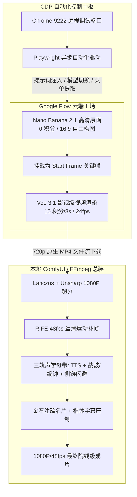
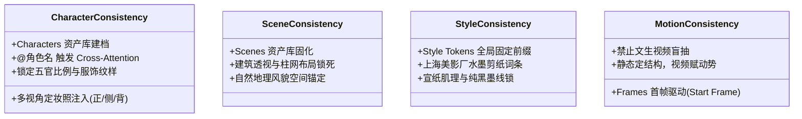

# Google Flow 工业级影视动画标准操作流程与使用指南 (SOP)

> **文档版本**：v1.0 (Master Edition)  
> **归档日期**：2026年10月10日  
> **适用项目**：北宋杨家将及后续所有“云端 Google Flow + 本地 ComfyUI”协同影视项目  
> **编写团队**：AI 工业化影视制作工程组  

---

## 一、系统定位与环境拓扑

Google Flow（前身包含 Google FX / VideoFX 实验项目）是 Google 推出的次世代多模态生成式影视制作工作台。在本套工业化制作流中，Google Flow 承担**“云端高阶分镜原画生成与影视级动态视频生成”**的核心枢纽，与本地 RTX 4060 Ti（16GB）显卡的 ComfyUI 形成**“云端超强生成 + 本地精细化超分、补帧与声学总成”**的互补闭环。



### 1. 基础软硬件环境要求
* **浏览器环境**：Google Chrome（必须开启 CDP 远程调试端口 `9222`）；
* **调试启动命令**（Windows 快捷方式或 CMD）：
  ```cmd
  chrome.exe --remote-debugging-port=9222 --user-data-dir="C:\ChromeDebug"
  ```
* **自动化依赖库**：`playwright`、`requests`、`opencv-python`、`pillow`；
* **访问入口**：`https://flow.google.com/`（需登录带 Flow / Pro 配额的 Google 账号）。

---

## 二、Google Flow 界面架构与功能全解析

```
+--------------------------------------------------------------------------------------------------+
| [三] Oct 10 Project  [Q 搜索资产]          [+] [?] [*] [:] [PRO 1,050]                           |
+--------------------------------------------------------------------------------------------------+
|  [侧边栏]      |  [Canvas 主画布工作区]                                                           |
|                |                                                                                 |
|  * All media   |    [卡片 1: 视频 8s]           [卡片 2: 图片 16:9]         [卡片 3: 失败待重试]  |
|  * Images      |    +-------------------+       +-------------------+       +-------------------+ |
|  * Videos      |    | [▶] 00:08:00      |       |  雪山行军原画     |       | [!] Failed (已退款)| |
|  * Characters  |    |  金殿死谏 (Veo)   |       |  (Nano Banana)    |       |  [重试][撤销][删除]| |
|  * Scenes      |    +-------------------+       +-------------------+       +-------------------+ |
|  * Tools       |                                                                                 |
|                |                                                                                 |
|  [垃圾箱]      +---------------------------------------------------------------------------------+
|  [收起侧栏]    |  [底部交互控制台]                                                               |
|                |  [+] [Agent]  [请输入生图或生视频提示词...]  [Video·720p·8s ▤ x1]  [➔ 提交]    |
+----------------+---------------------------------------------------------------------------------+
```

### 1. 左侧资产侧边栏 (Asset Sidebar)
* **All media / Images / Videos**：媒体类型分类过滤器，可快速按素材形式检索画布卡片；
* **Characters（角色资产库）**：用于建立剧中核心人物（如宋太宗、寇准、杨延平）的多视角参考卡，支持通过 `@角色名` 将人物面部与服装特征锁定注入；
* **Scenes（场景资产库）**：固定建筑、自然地貌（如开封大庆殿、五台山雪原、雁门关隘）的环境资产库；
* **Tools（工具箱）**：内置与自定义的生图/改图流水线。

### 2. Canvas 画布工作区 (Visual Canvas)
* **自由网格布局**：所有生成的图片与视频均以卡片形式散布在无限画布上，支持双击放大预览、拖拽排列、滚轮缩放；
* **卡片右上角快捷操作**：
  * 单击图片卡片可一键**“作为起始帧 (Use as Start Frame)”**、**“以此图扩写 (Remix)”**或**“保存至项目 (Save to Projects)”**；
  * 视频卡片悬停出现播放按钮 `[▶]`、时长指示器 `00:08:00` 及三点菜单。

### 3. 底部核心控制台 (Input Bar)
* **输入文本框**：输入场景、主体、动势描述及风格词；
* **`[+]` 挂载食材 (Ingredients)**：可挂载起始关键帧图片、角色参考卡或场景参考卡；
* **模型/模式配置按钮**（关键操作点！）：
  * **Image 模式**：`Banana · 16:9 · x2 (0 credits)` —— 静态图片生成；
  * **Video 模式**：`Video · 720p · 8s · x1 (10 credits)` —— Veo 3.1 视频动态渲染。
* **`[➔]` 提交箭头**：发起生成任务。

---

## 三、标准化生片操作步骤 (SOP Step-by-Step)

### 步骤 1：原画定调（路线 A 原生 16:9 高清单图直出）
1. **核验当前模式**：确认底部输入栏右侧显示为 **`[Image · Nano Banana 2.1]`**，积分提示为 **`0 credits`**；
2. **输入风格锁提示词**：采用统一的“叙事主体 + 光影空间 + 美影厂工笔剪纸风”结构：
   ```text
   Cinematic wide shot. [具体场景与人物动作描绘]. Traditional Chinese ink wash cut-paper animation style, Shanghai Animation Film Studio aesthetic, crisp black ink lines, muted cel shading, textured raw rice paper, 8k cinematic lighting.
   ```
3. **点击提交**：Nano Banana 将并行产出 2 张高质量 16:9 概念帧（完全不消耗任何积分）；
4. **优选评定**：在画布上对比候选帧，挑选构图、透视与人物形态最符合分镜脚本的一张。

### 步骤 2：视频动态生成（Veo 3.1 关键帧驱动生视频）
1. **挂载首帧**：
   * 在选中的高清单图卡片上右键或点击工具图标，选择 **`Use as Start Frame`（作为起始帧）**；
   * 此时底部输入框左侧将出现该图片的缩略图标签；
2. **切换视频模型档位**：
   * 点击输入框右侧的模型配置按钮；
   * 将模式由 `Image` 切换为 **`Video`**；
   * 模型选择 **`Veo 3.1 - Lite`**；
   * 时长设置为 **`8s`**；
   * 数量设置为 **`x1`**；
   * 确认右侧提示扣除 **`10 credits`**；
3. **输入动势提示词（Motion Prompt）**：
   * **核心原则**：起始帧已经锁死了画面五官、服饰与场景结构，**Prompt 中严禁重复繁琐描写静态外貌，应重点描述机位运镜、大气流动与肢体动作**：
   ```text
   Camera tilts up smoothly from the snow-covered ground. Wind billows the yellow imperial flag vigorously, horses and soldiers advance steadily forward kicking up snow dust, solemn atmosphere, cinematic motion, 24fps.
   ```
4. **提交生成**：点击右侧箭头提交，系统进入云端排队与渲染；时长通常为 40~90 秒。

---

## 四、四大一致性锁定机制实用指南



1. **角色一致性（Characters Lock）**：
   * 在左侧 `Characters` 面板中点击新建角色，上传该角色的正面、45度侧面定妆参考图（建议由 Nano Banana 预先跑出）；
   * 在输入框中输入 `@角色名`，系统会自动将该角色的特征嵌入（Embedding）挂载至推理上下文，防止跨镜头变脸。
2. **场景一致性（Scenes Lock）**：
   * 在 `Scenes` 中固定开封大庆殿或五台山雪原的远景白模/概念图；
   * 作为 `Scene Ingredient` 引入，确保多机位拍摄时大殿梁柱颜色、台阶级数、窗棂样式分毫不差。
3. **风格一致性（Style Tokens Lock）**：
   * 每一个 Prompt 尾部必须机械附带 5 大金牌画风 Token：
     > `traditional Chinese ink wash cut-paper animation style, Shanghai Animation Film Studio aesthetic, crisp black ink lines, muted cel shading, textured raw rice paper.`
4. **动作连贯性（Frames / Start Frame Lock）**：
   * 彻底废除文生视频（Text-to-Video）盲抽模式；
   * 一律采用**“Nano Banana 高清图 $\rightarrow$ Start Frame $\rightarrow$ Veo 动态赋能”**的标准管线。

---

## 五、每日 100 积分风控守则与审计体系

### 1. 积分扣除规则一览表
| 模型 / 操作 | 单次扣费 | 每日免费配额 | 计费特性 |
| :--- | :---: | :---: | :--- |
| **Nano Banana 2.1 (生图)** | **0 积分** | 独立免费配额 | 无限次抽卡，不消耗 Veo 视频积分 |
| **Veo 3.1 - Lite (视频)** | **10 积分** | 每日赠送 50 积分 | 8秒 720p 视频渲染，性价比最高，**工业生产推荐** |
| **Veo 3.1 - Fast (视频)** | **20 积分** | 扣除账户余额 | 生成速度较快，画质与 Lite 相当 |
| **Veo 3.1 - Quality (视频)**| **100 积分** | 扣除账户余额 | 超高算力，单次即耗尽当日上限，日常严禁使用 |

### 2. 每日 100 积分硬上限风控规范
* **生产预算管控**：每日最多发起 **10 次 Veo 3.1 Lite 视频任务**（消耗 100 积分），达到后立即熔断；
* **本地账本自动同步**：所有任务发起前，脚本必须校验并写入账本文件：
  [`output/YYYY-MM-DD/flow_credit_ledger.json`](file:///d:/ai_projects/ComfyUI/output/2026-10-10/flow_credit_ledger.json)。
* **退款对账规则**：若任务因安全拦截或网络异常失败，系统会触发 `You will be refunded`，账本必须记录为 `cost: 0 (Refunded)`，恢复对应额度。

---

## 六、安全审核策略（Prominent People Policy）规避与脱敏手册

### 1. 拦截原理
Google Veo 部署了严格的知名人物保护安全策略（Prominent People Policy），其包含一个针对**全球历史君主、名臣将相、公众人物及政治人物**的敏感词识别拦截网。一旦 Prompt 中直接出现真实人名，系统会在推理前直接拒绝并弹窗退款。

### 2. 实体去名化改写对照表 (De-identification Standards)
| 剧中历史人物 | 严禁使用的词汇 (拦截触发) | 标准规范改写词汇 (100% 顺畅过审且画质更优) |
| :--- | :--- | :--- |
| **宋太宗（赵光义）** | `Emperor Taizong`, `Zhao Guangyi` | `Solemn Chinese emperor seated on ornate dragon throne in yellow imperial dragon robe` |
| **寇准** | `Prime Minister Kou Zhun`, `Kou Zhun`| `An ancient prime minister in official crimson silk robes and winged black hat` |
| **杨业（令公）** | `General Yang Ye`, `Yang Ye` | `A battle-hardened veteran commander in gleaming steel lamellar armor with grey beard and fierce eyes` |
| **潘美（潘仁美）** | `General Pan Mei`, `Pan Renmei` | `A calculating imperial military marshal in dark brocade armor with cold demeanor` |
| **宋真宗（赵恒）** | `Emperor Zhenzong`, `Zhao Heng` | `A youthful crowned royal prince in silk embroidered imperial attire` |
| **萧太后** | `Empress Dowager Xiao` | `A commanding northern Liao empress dowager in ornate fur-lined regal nomadic gown and golden headdress` |

> [!TIP]
> **编写技巧**：用“官衔/军阶 + 服饰颜色质地 + 标志性帽子/铠甲 + 面部胡须神态”替代具体姓名。AI 在还原大宋服饰制式（如展脚幞头、团花绫罗、明光铠）方面具备极高的知识库精度。

---

## 七、成片提取与下载标准化操作

在 Google Flow 编辑器视图（`/edit/...`）中，视频采用 Web Component 流式渲染，主 DOM 不暴露原生 `<video>` 标签。标准下载捕获步骤如下：

```
[顶部操作栏]  [<- 返回]  [镜头标题]  [下载图标 📥]  [删除 🗑️]  [Done 按钮]
                                         |
                                         v (点击展开 Angular 菜单)
                              +--------------------------+
                              | 270p Animated GIF        |
                              | [✓] 720p Original size   | <--- 点击此项下载满血原片
                              | 1080p Upscaled           |
                              | 4K Upscaled              |
                              +--------------------------+
```

1. **手动操作**：
   * 在视频播放详情界面，点击顶部工具栏的 **`[📥 Download media]`** 图标；
   * 在弹出的下拉面板中，选择 **`720p Original size`**；
   * 浏览器将自动将原生满血 8 秒 MP4 视频保存至系统 Downloads 目录。
2. **自动化脚本捕获（Playwright CDP）**：
   ```python
   # 定位并点击 720p 原生选项
   btn_720p = page.locator("[role='menuitem']:has-text('720p')").first
   async with page.expect_download(timeout=10000) as download_info:
       await btn_720p.click()
   download = await download_info.value
   await download.save_as(target_path)
   ```
3. **返回画板**：下载完成后，务必点击右上角 **`Done`** 按钮，使工作台平稳退回项目主画布。

---

## 八、常用自动化运维工具脚本索引

| 脚本工具文件 | 核心职责 | 终端运行示例 |
| :--- | :--- | :--- |
| [`tools/pipeline_route_a_flow_native.py`](file:///d:/ai_projects/ComfyUI/tools/pipeline_route_a_flow_native.py) | 路线 A 自动化控制引擎（单图直出 + Veo 视频） | `cmd /c python tools/pipeline_route_a_flow_native.py` |
| [`tools/pipeline_route_a_postprocess_relay.py`](file:///d:/ai_projects/ComfyUI/tools/pipeline_route_a_postprocess_relay.py) | 本地 1080P/48fps 超分补帧与三轨声画总装引擎 | `cmd /c python tools/pipeline_route_a_postprocess_relay.py` |
| [`tools/verify_final_results.py`](file:///d:/ai_projects/ComfyUI/tools/verify_final_results.py) | 产物参数、分辨率、帧率与元数据自动化质检 | `cmd /c python tools/verify_final_results.py` |
| [`tools/clean_failed_card.py`](file:///d:/ai_projects/ComfyUI/tools/clean_failed_card.py) | 自动化清理 Flow 画布上的失败废卡 | `cmd /c python tools/clean_failed_card.py` |

---
*本文档为 Google Flow 工业化生产权威 SOP，执行中如有平台 UI 升级，应在此文档中同步更新版本号。*
