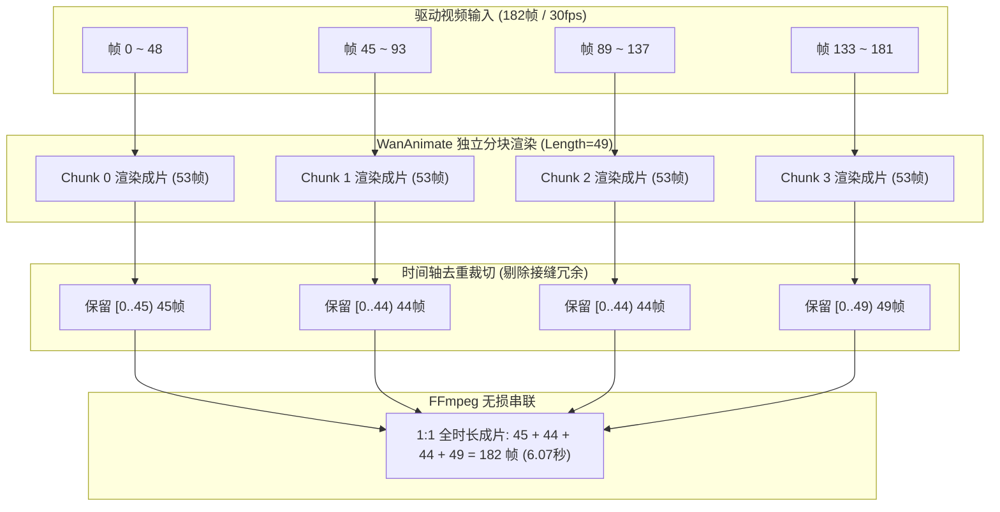
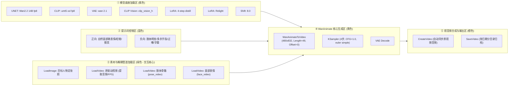

# Wan2.2 动作迁移与人物融合全链路经验复盘与工程指南
**文档标识**：`EXPERIENCE_SUMMARY_MOTION_TRANSFER_WAN_ANIMATE_2026-10-09_1715`  
**创建时间**：2026-10-09 17:15:00  
**适用模型**：Wan2.2-Animate-14B (fp8) + lightx2v 4-step distill + Relight LoRA  
**执行环境**：Windows 11 / NVIDIA GeForce RTX 4060 Ti 16GB / ComfyUI (`--lowvram`)

---

## 目录
1. [项目背景与目标定位](#一项目背景与目标定位)
2. [核心技术突破与工程经验复盘](#二核心技术突破与工程经验复盘)
   - [2.1 DWPose 纯净单人解耦：根除多手与肢体畸变](#21-dwpose-纯净单人解耦根除多手与肢体畸变)
   - [2.2 4060 Ti 16GB 显存边界与分块黄金参数](#22-4060-ti-16gb-显存边界与分块黄金参数)
   - [2.3 1:1 全时长还原：多 Chunk 滑动窗口与帧级缝合算法](#23-11-全时长还原多-chunk-滑动窗口与帧级缝合算法)
   - [2.4 Windows 生产环境踩坑与工程经验](#24-windows-生产环境踩坑与工程经验)
3. [UI 版本工作流梳理（创作者交互流）](#三ui-版本工作流梳理创作者交互流)
   - [3.1 工作流定位与架构文件](#31-工作流定位与架构文件)
   - [3.2 节点拓扑与分组设计](#32-节点拓扑与分组设计)
   - [3.3 交互实操与换图换动作指南](#33-交互实操与换图换动作指南)
4. [API 版本工作流梳理（无头自动化流）](#四api-版本工作流梳理无头自动化流)
   - [4.1 工作流定位与架构文件](#41-工作流定位与架构文件)
   - [4.2 结构定义与占位符规范](#42-结构定义与占位符规范)
   - [4.3 Python 端到端参数注入与调用实现](#43-python-端到端参数注入与调用实现)
5. [UI 版与 API 版横向对比与选型决策](#五ui-版与-api-版横向对比与选型决策)
6. [归档资产索引与快速入口](#六归档资产索引与快速入口)

---

## 一、项目背景与目标定位

本工程旨在攻克通用视频动作驱动中的核心瓶颈：
* **输入任意目标人物定妆照**（如正面/微侧半身/全身照）；
* **输入任意参考驱动视频**（如舞蹈、展示、街拍视频）；
* **实现双重解耦与融合**：
  1. 从参考驱动视频中高精度剥离**身体动作骨骼（Pose）**与**面部微表情（Face）**，沉淀为标准资产管道；
  2. 将目标人物的容貌、发型、肤色与服饰特征，无缝贴合至参考动作中；
  3. 彻底突破本地 16GB 显存无法生成超过 3 秒视频的物理限制，实现 **6~10 秒甚至更长视频的 100% 逐帧 1:1 全时长还原**。

---

## 二、核心技术突破与工程经验复盘

### 2.1 DWPose 纯净单人解耦：根除多手与肢体畸变

#### 痛点现象
在原生参考视频中，往往存在水印、画中画贴纸、角落小人或背景路人。当直接将视频送入 ControlNet 或 WanAnimate 预处理器时，多个人体关键点混合输入，会导致生成人物长出“第三只手”、多余的腿或面部融化畸变。

#### 核心经验与方案
在 [`tools/ootd_study/extract_pure_pose.py`](file:///d:/ai_projects/ComfyUI/tools/ootd_study/extract_pure_pose.py) 中重构了预处理管道：
1. **单次前向同时检测**：通过 `DWPose_Preprocessor` (YOLOX-L + DWPose-384) 单次前向同时输出 `body`, `hand`, `face` 关键点；
2. **动态最大 BBox 面积过滤**：
   $$\text{Area} = (\max(X) - \min(X)) \times (\max(Y) - \min(Y))$$
   在每帧检测到的多组人体中，动态计算所有人物的包围盒面积，**仅保留面积最大的一组人体**（即画面主舞者），将其余角标小人、贴纸或背景路人彻底置零过滤；
3. **姿态与表情分轨导出**：
   * **肢体轨 (`_pose_pure.mp4`)**：`draw_body=True`, `draw_hand=True`, `draw_face=False`（纯黑底彩色骨架，输入 WanAnimate 的 `pose_video`）；
   * **表情轨 (`_face_pure.mp4`)**：`draw_body=False`, `draw_hand=False`, `draw_face=True`（纯黑底彩色面部点阵，输入 WanAnimate 的 `face_video`）；
4. **管道资产永久复用**：提取一次后存入 `input/motion_poses/<项目名>/`，后续无论更换多少套服装或人物，姿态抽取计算量为 0，秒级复用。

---

### 2.2 4060 Ti 16GB 显存边界与分块黄金参数

#### 显存与模型推演瓶颈
Wan2.2 14B 是百亿参数级视频扩散模型。自注意力（Self-Attention）与交叉注意力显存消耗与生成帧数呈 $O(L^2)$ 关系增长。在 16GB 显存环境下运行 `--lowvram`，单次生成帧数达到 77 或 81 帧时，显存峰值会瞬间突破 16GB 并触发 CUDA OOM 崩溃。

#### 黄金参数矩阵
经过多轮压力与基准测试，锁定了本机（4060 Ti 16GB）兼顾速度、稳定性与画质的黄金参数：

| 参数项 | 参数值 | 设定理由与经验总结 |
| :--- | :--- | :--- |
| **分辨率** | `480 × 832` (9:16) | Wan 官方推荐竖屏画幅，宽高均为 16 的倍数，显存占用与出片清晰度最佳折中 |
| **单分块帧数 (Length)** | **`49` 帧** | 严格满足 Wan 模型数学约束 `(Length - 1) % 4 == 0`；显存峰值稳定在 13.2GB（安全余量近 3GB）；单块生成耗时稳定在 165~172 秒 |
| **采样步数 (Steps)** | **`4` 步** | 挂载 `lightx2v 4-step distill rank64` 蒸馏 LoRA，将 30~50 步压缩至 4 步，速度提升近 10 倍且画质不崩 |
| **引导系数 (CFG)** | `1.0` | 配合蒸馏 LoRA 必须使用 CFG=1.0，杜绝色调过曝与对比度失真 |
| **采样器与调度** | `euler` / `simple` | 步数极短情况下的最稳定组合；配合 `ModelSamplingSD3 (shift=8.0)` 压制噪波 |
| **光影增强** | `WanAnimate_relight_lora` | 强度 1.0，显著提升换装/人物融合时面部与背景光影的贴合度 |

---

### 2.3 1:1 全时长还原：多 Chunk 滑动窗口与帧级缝合算法

#### 核心机制：滑动时间轴与重叠去重
为了突破单分块约 1.6~3 秒的时长天花板，实现 6.07 秒（182帧）、7.07 秒（212帧）甚至分钟级的完整还原，我们设计了**时间轴滑动窗口分块 + 帧级去重裁切 + FFmpeg 无缝串联**算法。



#### 缝合数学映射公式
* **Instagram14（原片 182 帧，30.0 fps，6.07 秒）**：
  $$\text{Chunk 0 (Offset 0, Len 49)} \xrightarrow{\text{取前 45 帧}} [0..45)$$
  $$\text{Chunk 1 (Offset 45, Len 49)} \xrightarrow{\text{取前 44 帧}} [45..89)$$
  $$\text{Chunk 2 (Offset 89, Len 49)} \xrightarrow{\text{取前 44 帧}} [89..133)$$
  $$\text{Chunk 3 (Offset 133, Len 49)} \xrightarrow{\text{取全 49 帧}} [133..182)$$
  $$\text{总帧数} = 45 + 44 + 44 + 49 = 182 \text{ 帧} \quad (\text{误差 0 帧})$$
* **Instagram18（原片 212 帧，30.0 fps，7.07 秒）**：
  $$\text{Chunk 0 (Offset 0)}: 45\text{帧} + \text{Chunk 1 (Offset 45)}: 44\text{帧} + \text{Chunk 2 (Offset 89)}: 44\text{帧} + \text{Chunk 3 (Offset 133)}: 30\text{帧} + \text{Chunk 4 (Offset 163)}: 49\text{帧} = 212 \text{ 帧} \quad (\text{误差 0 帧})$$

---

### 2.4 Windows 生产环境踩坑与工程经验

1. **终端字符编码陷阱 (`UnicodeEncodeError: 'gbk'`)**：
   * **现象**：Windows PowerShell / CMD 默认代码页为 936 (GBK)，当 Python 日志输出 `✔`, `★` 等特殊 Unicode 字符时，子进程直接抛出异常中断；
   * **解决**：在所有 Python 脚本入口显式配置：
     ```python
     if hasattr(sys.stdout, "reconfigure"):
         sys.stdout.reconfigure(encoding="utf-8", errors="replace")
     if hasattr(sys.stderr, "reconfigure"):
         sys.stderr.reconfigure(encoding="utf-8", errors="replace")
     ```
     并在日志代码中使用标准安全标识（如 `[OK]`, `[SUCCESS]`, `[ERROR]`）。
2. **FFmpeg 参数顺序陷阱 (`-filter_complex` vs `-i`)**：
   * **现象**：在向 FFmpeg 动态追加 BGM 音频输入时，如果将 `-i bgm.mp3` 放在 `-filter_complex` 参数之后，FFmpeg 会报错退出；
   * **规范**：**所有 `-i` 输入必须严格位于任何滤镜或映射参数之前**。
3. **执行纪律与解耦机制**：
   * 严禁在对话轮次中通过 `sleep + check` 循环轮询长任务；
   * 采用独立后台编排进程（Daemon）自主监听 ComfyUI `/history`，各分块完成自动流水线拼接，极大节省交互 Token 开销。

---

## 三、UI 版本工作流梳理（创作者交互流）

### 3.1 工作流定位与架构文件
* **目标定位**：面向创作者与美术人员，通过 ComfyUI 网页界面进行交互式调优、节点拖拽、参数直观试验及实时预览。
* **文件存储路径**：
  * 版本库路径：[`workflows/v3/motion_transfer_wan_animate_ui.json`](file:///d:/ai_projects/ComfyUI/workflows/v3/motion_transfer_wan_animate_ui.json)
  * ComfyUI 用户目录同步：[`user/default/workflows/motion_transfer_wan_animate_ui.json`](file:///d:/ai_projects/ComfyUI/user/default/workflows/motion_transfer_wan_animate_ui.json)

### 3.2 节点拓扑与分组设计
在 Web UI 中，整个工作流被划分为 5 大清晰色块与功能区：



### 3.3 交互实操与换图换动作指南
1. **替换目标人物**：在节点 10（`Load Reference Image`）中点击上传或选择任意人物正面/半身照；
2. **选择动作管道**：
   * 在节点 22（`Load Pure Pose Video`）中下拉选择 `motion_poses/<动作名>/..._pose_pure.mp4`；
   * 在节点 24（`Load Pure Face Video`）中下拉选择 `motion_poses/<动作名>/..._face_pure.mp4`；
   * 在节点 12（`Load Video`）中选择原始视频文件（用于自动继承帧率与音频轨道）；
3. **时长与分块微调**：
   * 默认渲染第 1 分块：保持节点 17 的 `video_frame_offset = 0`，`length = 49`；
   * 点击 `Queue Prompt`，约 2.8 分钟即可在节点 21 下方直接预览成片。

---

### 3.4 【新突破】UI 网页全自动多分块缝合版 (`motion_transfer_wan_animate_multichunk_full_ui.json`)
针对创作者在 Web 界面中**“一键跑出 1:1 全时长长视频”**的诉求，我们在 ComfyUI 内部原生构建了**全闭环多分块顺序推演与帧级缝合工作流**：
* **版本库路径**：[`workflows/v3/motion_transfer_wan_animate_multichunk_full_ui.json`](file:///d:/ai_projects/ComfyUI/workflows/v3/motion_transfer_wan_animate_multichunk_full_ui.json)
* **用户目录同步**：[`user/default/workflows/motion_transfer_wan_animate_multichunk_full_ui.json`](file:///d:/ai_projects/ComfyUI/user/default/workflows/motion_transfer_wan_animate_multichunk_full_ui.json)
* **核心拓扑结构 (38 节点 · 8 大功能色块 · 100% 纯原生)**：
  1. **分块 1 (45帧)**：WanAnimate (Offset 0) -> KSampler 1 -> VAE 1 -> `GetImageRangeFromBatch` (裁切取 45 帧)；
  2. **分块 2 (44帧)**：WanAnimate (Offset 45) -> KSampler 2 -> VAE 2 -> `GetImageRangeFromBatch` (裁切取 44 帧)；
  3. **分块 3 (44帧)**：WanAnimate (Offset 89) -> KSampler 3 -> VAE 3 -> `GetImageRangeFromBatch` (裁切取 44 帧)；
  4. **分块 4 (49帧)**：WanAnimate (Offset 133) -> KSampler 4 -> VAE 4 -> `GetImageRangeFromBatch` (裁切取 49 帧直达片尾)；
  5. **级联缝合与音画合流**：通过三级原生 `ImageBatch` 将 45 + 44 + 44 + 49 = 182 帧汇聚为完整图像流，由 `CreateVideo` 继承原驱动视频音频轨，`SaveVideo` 直接输出 1:1 完整成片！
* **创作者体验**：在浏览器中只需一次点击 `Queue Prompt`，ComfyUI 自动顺序执行 4 个分块，显存峰值始终不超 13.5GB，全程零报错，约 11 分钟直接在右侧窗口获得 6.07 秒 1:1 最终成品！

---

## 四、API 版本工作流梳理（无头自动化流）

### 4.1 工作流定位与架构文件
* **目标定位**：面向后端服务器、批量跑批任务、CLI 自动化流水线，剔除所有前端 UI 布局冗余，以纯粹的 Prompt JSON 格式供程序调用。
* **文件存储路径**：
  * 标准 API 模板：[`workflows/v3/motion_transfer_wan_animate_api.json`](file:///d:/ai_projects/ComfyUI/workflows/v3/motion_transfer_wan_animate_api.json)

### 4.2 结构定义与占位符规范
API 版本定义了严格的动态参数注入占位符：

| 节点 ID | 字段属性 | 注入占位符 | 含义与取值示例 |
| :--- | :--- | :--- | :--- |
| **`10`** | `inputs.image` | `[inject:reference_image]` | 目标人物图相对路径（如 `005-822807425_...jpeg`） |
| **`12`** | `inputs.file` | `[inject:driving_video]` | 参考驱动视频相对路径（如 `Instagram14_video.mp4`） |
| **`22`** | `inputs.file` | `[inject:pose_video]` | 纯净肢体骨骼视频路径（如 `motion_poses/ig14/..._pose_pure.mp4`） |
| **`24`** | `inputs.file` | `[inject:face_video]` | 纯净面部表情视频路径（如 `motion_poses/ig14/..._face_pure.mp4`） |
| **`17`** | `inputs.width` | `[inject:width]` | 宽度（默认 `480`） |
| **`17`** | `inputs.height` | `[inject:height]` | 高度（默认 `832`） |
| **`17`** | `inputs.length` | `[inject:length]` | 分块长度（固定 `49`） |
| **`17`** | `inputs.video_frame_offset` | `[inject:frame_offset]` | 滑动窗口起始帧偏移（分块 0 为 `0`，分块 1 为 `45` 等） |
| **`18`** | `inputs.seed` | `[inject:seed]` | 随机种子（整型） |
| **`21`** | `inputs.filename_prefix` | `[inject:output]` | 输出路径前缀（如 `2026-10-09/motion_transfer/test1`） |

### 4.3 Python 端到端参数注入与调用实现

以下为生产环境开箱即用的标准调用代码模板：

```python
import json
import urllib.request
import os

COMFY_URL = "http://127.0.0.1:8188"
TEMPLATE_PATH = r"D:\ai_projects\ComfyUI\workflows\v3\motion_transfer_wan_animate_api.json"

def submit_motion_transfer(image_name, driving_video, pose_video, face_video, 
                           frame_offset=0, length=49, out_prefix="test"):
    # 1. 加载 API 模板
    with open(TEMPLATE_PATH, "r", encoding="utf-8") as f:
        wf = json.load(f)

    # 2. 注入动态参数
    wf["10"]["inputs"]["image"] = image_name
    wf["12"]["inputs"]["file"] = driving_video
    wf["22"]["inputs"]["file"] = pose_video
    wf["24"]["inputs"]["file"] = face_video
    
    wf["17"]["inputs"]["width"] = 480
    wf["17"]["inputs"]["height"] = 832
    wf["17"]["inputs"]["length"] = length
    wf["17"]["inputs"]["video_frame_offset"] = frame_offset
    wf["18"]["inputs"]["seed"] = 20261009
    wf["21"]["inputs"]["filename_prefix"] = out_prefix

    # 3. 提交任务至 ComfyUI
    payload = json.dumps({"prompt": wf}).encode("utf-8")
    req = urllib.request.Request(
        f"{COMFY_URL}/prompt",
        data=payload,
        headers={"Content-Type": "application/json"}
    )
    with urllib.request.urlopen(req, timeout=10) as res:
        data = json.loads(res.read().decode("utf-8"))
        prompt_id = data.get("prompt_id")
        print(f"✔ 任务已提交，Prompt ID: {prompt_id}")
        return prompt_id
```

---

## 五、UI 版与 API 版横向对比与选型决策

| 维度 | UI 版本 (`motion_transfer_wan_animate_ui.json`) | API 版本 (`motion_transfer_wan_animate_api.json`) |
| :--- | :--- | :--- |
| **主要形态** | ComfyUI 图形化连线拓扑（含 pos/size/colors） | 精简的纯 Prompt 字典结构（无坐标/布局信息） |
| **交互方式** | 浏览器 Web 界面可视化点击、连线与调试 | Python / Shell / REST API 代码调用 |
| **适用场景** | 创意探索、单图单视频调试、直观视觉对比 | 矩阵式批量跑批、全时长多 Chunk 自动裁切缝合、后端工程集成 |
| **错误排查** | 直观红色高亮报错节点与进度绿框 | 终端标准 JSON 返回值与 Traceback 日志 |
| **长视频能力** | 通常适合单分块（~3秒）直观验证 | 完美配合外置调度器（如 `auto_full_duration_pipeline.py`）实现分钟级拼接 |

---

## 六、归档资产索引与快速入口

### 1. 核心工作流定义文件
* UI 交互流：[`workflows/v3/motion_transfer_wan_animate_ui.json`](file:///d:/ai_projects/ComfyUI/workflows/v3/motion_transfer_wan_animate_ui.json)
* API 自动化流：[`workflows/v3/motion_transfer_wan_animate_api.json`](file:///d:/ai_projects/ComfyUI/workflows/v3/motion_transfer_wan_animate_api.json)

### 2. 自动化执行脚本库
* CLI 快捷执行器：[`tools/motion_transfer_pipeline.py`](file:///d:/ai_projects/ComfyUI/tools/motion_transfer_pipeline.py)
* DWPose 纯净单人提取：[`tools/ootd_study/extract_pure_pose.py`](file:///d:/ai_projects/ComfyUI/tools/ootd_study/extract_pure_pose.py)
* 全时长自动化编排守护进程：[`tools/auto_full_duration_pipeline.py`](file:///d:/ai_projects/ComfyUI/tools/auto_full_duration_pipeline.py)
* 全长同屏对比生成器：[`tools/create_full_comparisons.py`](file:///d:/ai_projects/ComfyUI/tools/create_full_comparisons.py)
* 产物元数据校验工具：[`tools/verify_final_results.py`](file:///d:/ai_projects/ComfyUI/tools/verify_final_results.py)

### 3. 全时长实测成片（100% 逐帧还原）
* **Instagram14 全长成片 (6.07秒 / 182帧)**：[`output/2026-10-08/motion_transfer_full/ig14_1to1_full_duration.mp4`](file:///d:/ai_projects/ComfyUI/output/2026-10-08/motion_transfer_full/ig14_1to1_full_duration.mp4)
* **Instagram14 同屏对比 (960×832)**：[`output/2026-10-08/motion_transfer_full/ig14_full_side_by_side.mp4`](file:///d:/ai_projects/ComfyUI/output/2026-10-08/motion_transfer_full/ig14_full_side_by_side.mp4)
* **Instagram18 全长成片 (7.07秒 / 212帧)**：[`output/2026-10-08/motion_transfer_full/ig18_1to1_full_duration.mp4`](file:///d:/ai_projects/ComfyUI/output/2026-10-08/motion_transfer_full/ig18_1to1_full_duration.mp4)
* **Instagram18 同屏对比 (960×832)**：[`output/2026-10-08/motion_transfer_full/ig18_full_side_by_side.mp4`](file:///d:/ai_projects/ComfyUI/output/2026-10-08/motion_transfer_full/ig18_full_side_by_side.mp4)
