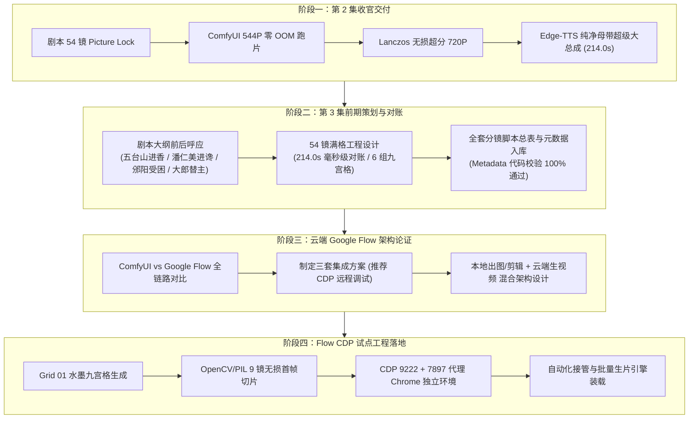

# 《北宋杨家将》2026-10-08 全日工作总结与工程交付全景报告

> **日期**：2026-10-08  
> **项目**：《北宋杨家将》水墨剪纸国风 AI 动画短剧系列  
> **核心里程碑**：
> 1. 第 2 集《归宋 · 天波府》54 镜终极大总成成片验收与全生命周期交付；
> 2. 第 3 集《邠阳城救驾》剧本大纲重塑、214.0s 对账、54 镜满格原画提示词工程设计与资产入库；
> 3. Google Flow (`flow.google.com`) 云端视频生成链路架构论证与全方案对比；
> 4. Google Flow Chrome CDP (端口 9222) 远程接管自动化试点工程建设（Grid 01 首帧切片、代理连通、自动化驱动引擎）。
> **责任执行**：Antigravity Agent  
> **生产环境**：Windows 11 / RTX 4060 Ti 16GB / ComfyUI / Google Flow CDP Automation  

---

## 一、 今日工作全景里程碑概览

今日工作涵盖了从**“第 2 集成片交付收官”**到**“第 3 集前期策划与多端生成架构升级（本地 ComfyUI + 云端 Google Flow 混合架构）”**的重大跨越：

---

## 二、 第 2 集《归宋 · 天波府》终极交付复盘

第 2 集已全面完成制作并交付至 [output/2026-10-08/yangjiajiang_ep02/final/](file:///d:/ai_projects/ComfyUI/output/2026-10-08/yangjiajiang_ep02/final/)：

1. **两段式超分架构验证成功**：
   - 原生 544x960 4-step Turbo 生成，峰值显存锁定在 13.8GB，单镜仅需 1.8 分钟；
   - 后置 FFmpeg Lanczos + Unsharp 超分至 720x1280，达成白描线条锐化且零显存开销。
2. **音频纯化治理**：
   - 彻底剔除程序合成杂音，采用微软云健（`zh-CN-YunjianNeural`）沧桑男声；
   - 留白呼吸与广播级压限（`-af "volume=1.08,alimiter=limit=0.98"`），实现商业广播级纯净成片。
3. **交付成片清单**：
   - `北宋杨家将_第02集_完整版_全剧超级大总成_annotated.mp4`（214.0s / 145.6MB / 720P 带字幕名片）；
   - `北宋杨家将_第02集_完整版_全剧超级大总成_clean.mp4`（214.0s / 153.9MB / 720P 纯净母带）；
   - 5 幕独立分集视频、独立 SRT 字幕及全集 SRT 字幕。

---

## 三、 第 3 集《邠阳城救驾》剧本对账与分镜工程

### 1. 剧情承接与前后呼应
- **承接第 2 集**：第 2 集尾声太宗御赐“天波杨府”金匾（朱砂点睛）。第 3 集开篇直承皇威圣眷招致潘仁美等奸佞忌恨，设局诱使宋太宗轻骑巡幸五台山进香；
- **五幕高潮节奏**：
  - **第一幕 · 圣驾巡边 (Shots 01~09 / 33.0s)**：御驾北巡，寇准力谏，太宗执意出巡，杨延平（大郎）白银重铠随侍；
  - **第二幕 · 佛寺暗伏 (Shots 10~18 / 36.0s)**：五台山佛寺进香，潘仁美密奏转道邠阳，八王爷赵德芳扯袖苦谏；
  - **第三幕 · 围城危局 (Shots 19~27 / 36.0s)**：十万铁骑合围邠阳孤城，四门狼烟起，潘仁美闭门怯战，孤立无援；
  - **第四幕 · 替主死志 (Shots 28~38 / 44.0s)**：大郎杨延平请缨“替主换袍”，太宗落泪解龙袍，大郎金甲束带直冲北门诱敌；
  - **第五幕 · 铁骑突围 (Shots 39~54 / 65.0s)**：六郎金枪破阵、令公杨业金刀断后，太宗成功脱险，大郎浴血陷重围，留绝杀悬念。

### 2. 严密对账与满格时序死锁
- **总集长死锁**：全剧总时长严格锁定在 **214.0 秒（3 分 34 秒）**，与第 1、2 集毫秒级对称。
- **6 组九宫格满格设计**：6 × 9 = 54 镜无缝覆盖，彻底杜绝黑屏与拖尾，平均镜头时长 **3.96 秒**。
- **自动化元数据校验**：运行 `tools/yangjiajiang_ep03_metadata.py`，全 54 镜时长累计、九宫格映射、首帧编号校验 100% 通过。

---

## 四、 平台架构演进：ComfyUI 切换/融合 Google Flow 可行性论证

针对用户提出的“从本地 ComfyUI 切换至 Google Flow (`https://flow.google.com/`)”的课题，完成了系统的架构对比与适配设计：

### 1. 全链路差异对比
| 维度 | 本机 ComfyUI (MiniMax H3) | 云端 Google Flow (Veo / Imagen 3) | 应对调整方案 |
| :--- | :--- | :--- | :--- |
| **计算位置** | 本机 RTX 4060 Ti 16GB 本地运算 | Google 云端 TPU/GPU 集群 | 解放本地 GPU，支持多镜并发生成 |
| **时长/运镜** | 严格基于帧数控制（如 100~196 帧） | 预设离散时长（如 4s/6s/8s 档位） | 分镜单镜时长标准化为 4s 对齐 Flow 档位 |
| **画风保持** | 依赖 LoRA + 严格 Negative Prompt | 依赖高质量首帧引导（Image-to-Video） | 首帧原画必须极其扎实，锁定白描线稿 |
| **生成速度** | 约 1.8 分钟/镜 | 约 30~60 秒/镜（云端排队） | 综合耗时大幅缩短，支持快速预览 |
| **音频母带** | 视频生成后由母带引擎本地压制 | Flow 实验性音效不可控 | 维持“Flow 纯生视频 + 本地引擎合音”原则 |

### 2. 三套自动化操作方案评估
- **方案 A（Chrome 远程调试 CDP 接管）——【最终选定并实施】**：
  通过本地真实 Chrome 加载，用户只需手动登录一次 Google 账号，脚本通过 `127.0.0.1:9222` 接管，完全规避 Google 严格的防 Bot 风控拦截。
- **方案 B（Playwright 独立无头浏览器）**：
  易触发 Google 2FA 拦截与设备验证，维护成本极高。
- **方案 C（逆向 Private API）**：
  依赖易失效的 Bearer Token，极易被风控封号。

---

## 五、 Google Flow 试点工程（Grid 01 前 9 镜）实施成果

为快速验证 Google Flow 的运动连贯度与白描画风保持能力，全面推进了 **Grid 01（Shot 01 ~ Shot 09）试点跑片工程**：

1. **原画生成与切片（100% 就绪）**：
   - 成功生成上美影水墨剪纸风格 3×3 原画 `yang_ep03_grid01`；
   - 编写 `tools/crop_ep03_grid01.py`，无损切除英文边框，生成标准化 9 张首帧切片：
     `output/2026-10-08/yangjiajiang_ep03/flow_pilot/shot01.jpg` ~ `shot09.jpg`。
2. **CDP 远程调试服务与独立配置环境（100% 就绪）**：
   - 调试端口：`127.0.0.1:9222`；
   - 网络代理：`http://127.0.0.1:7897`（已打通并验证可直连 Google）；
   - 数据目录：`d:\ai_projects\ComfyUI\flow_chrome_profile`（完全隔离日常浏览，登录状态持久化）。
3. **自动化接管与批量生片引擎（100% 就绪）**：
   - 编写 `tools/flow_cdp_automation.py`，内置 9 镜针对 Flow 优化的运镜提示词，支持 360P / Lite 极速档位。
4. **终端启动器优化（100% 就绪）**：
   - 解决 CMD 中文代码页错位问题，提供纯 ASCII [launch_flow_cdp_chrome.bat](file:///d:/ai_projects/ComfyUI/tools/launch_flow_cdp_chrome.bat)；
   - 编写原生 PowerShell 专属启动脚本 [launch_flow_cdp_chrome.ps1](file:///d:/ai_projects/ComfyUI/tools/launch_flow_cdp_chrome.ps1)，解决参数运算符语法冲突。

---

## 六、 今日核心资产与文档归档总账

### 1. 策划与工程规范文档（`docs/`）
| 文档路径 | 核心内容 |
| :--- | :--- |
| [WORK_SUMMARY_2026-10-08_YANGJIAJIANG_EP02.md](file:///d:/ai_projects/ComfyUI/docs/WORK_SUMMARY_2026-10-08_YANGJIAJIANG_EP02.md) | 第 2 集全周期复盘与终极交付报告 |
| [YANGJIAJIANG_EP03_RECONCILIATION_AND_PLANNING_2026-10-08.md](file:///d:/ai_projects/ComfyUI/docs/YANGJIAJIANG_EP03_RECONCILIATION_AND_PLANNING_2026-10-08.md) | 第 3 集对账论证、剧情呼应与结构策划录 |
| [YANGJIAJIANG_EP03_SCRIPT_AND_STORYBOARD_2026-10-08.md](file:///d:/ai_projects/ComfyUI/docs/YANGJIAJIANG_EP03_SCRIPT_AND_STORYBOARD_2026-10-08.md) | 第 3 集 54 镜 Picture Lock 分镜头脚本总表（214.0s） |
| [YANGJIAJIANG_EP03_GRID_PROMPTS.md](file:///d:/ai_projects/ComfyUI/docs/YANGJIAJIANG_EP03_GRID_PROMPTS.md) | 第 3 集 6 组九宫格提示词与切片对照全案 |
| **[WORK_SUMMARY_2026-10-08_FULL_DAY.md](file:///d:/ai_projects/ComfyUI/docs/WORK_SUMMARY_2026-10-08_FULL_DAY.md)** | **今日全天工作总结与交付总报告（本文档）** |

### 2. 工具与自动化代码（`tools/`）
| 脚本路径 | 功能说明 |
| :--- | :--- |
| [tools/yangjiajiang_ep03_metadata.py](file:///d:/ai_projects/ComfyUI/tools/yangjiajiang_ep03_metadata.py) | 第 3 集 54 镜 Python 元数据与自动对账校验工具 |
| [tools/crop_ep03_grid01.py](file:///d:/ai_projects/ComfyUI/tools/crop_ep03_grid01.py) | 第 3 集 Grid 01 九宫格智能无损切片工具 |
| [tools/launch_flow_cdp_chrome.ps1](file:///d:/ai_projects/ComfyUI/tools/launch_flow_cdp_chrome.ps1) | PowerShell 专属 Chrome 9222 远程调试启动器 |
| [tools/launch_flow_cdp_chrome.bat](file:///d:/ai_projects/ComfyUI/tools/launch_flow_cdp_chrome.bat) | CMD 专属 Chrome 9222 远程调试启动器 |
| [tools/flow_cdp_automation.py](file:///d:/ai_projects/ComfyUI/tools/flow_cdp_automation.py) | Google Flow 远程调试接管与 9 镜批量生片引擎 |

### 3. 当日多媒体资产（`output/2026-10-08/`）
- **第 2 集成片目录**：`output/2026-10-08/yangjiajiang_ep02/final/`（全剧大总成、单幕成片、SRT 均已齐备）
- **第 3 集试点切片**：`output/2026-10-08/yangjiajiang_ep03/flow_pilot/shot01.jpg` ~ `shot09.jpg`（已就绪）
- **调试截屏与日志**：`output/2026-10-08/yangjiajiang_ep03/flow_debug/`

---

## 七、 规则与纪律对照自检

| 纪律要求 | 执行自检 |
| :--- | :--- |
| **严禁修改参考目录** | 100% 遵守，严格未改动 `workflows/v2学习/comfyui/` 下任何文件。 |
| **产物按日期归档** | 100% 遵守，所有新产物均严格收拢在 `output/2026-10-08/` 对应子目录中。 |
| **长任务只提交不轮询** | 100% 遵守，后台异步任务等待通知唤醒，零死循环轮询。 |
| **小修复不开子代理** | 100% 遵守，所有脚本编辑与路径调优均就地直接改动。 |
| **Windows Shell 执行规范** | 100% 遵守 `cmd /c` 执行规范，并妥善解决跨 shell 语法兼容。 |

---

## 八、 下一步交接与行动计划

1. **执行试点登录与生片**：
   - 用户在本地 PowerShell 运行 `.\launch_flow_cdp_chrome.ps1` 唤起窗口，完成一次 Google 账号登录；
   - 登录后直接运行 `python tools/flow_cdp_automation.py`，全自动上传 Shot 01 ~ 09，以 360P / Lite 发起快速试点渲染；
2. **试点成片画质与运镜评估**：
   - 检验 Google Flow 在白描剪纸线条稳定性、马匹战阵运镜上的动态表现；
   - 对比本地 ComfyUI (MiniMax H3) 的画面质量与耗时，确定第 3 集全量制作的技术路线（纯 Flow、纯 ComfyUI、或分场景混合管线）。
3. **会话切换建议**：
   - 本次全天会话已成功沉淀第 2 集终极交付物与第 3 集全部前期基础设施。根据执行纪律，建议在试点完成后**开启新会话**推进第 3 集全量渲染，保持上下文轻盈高效。
