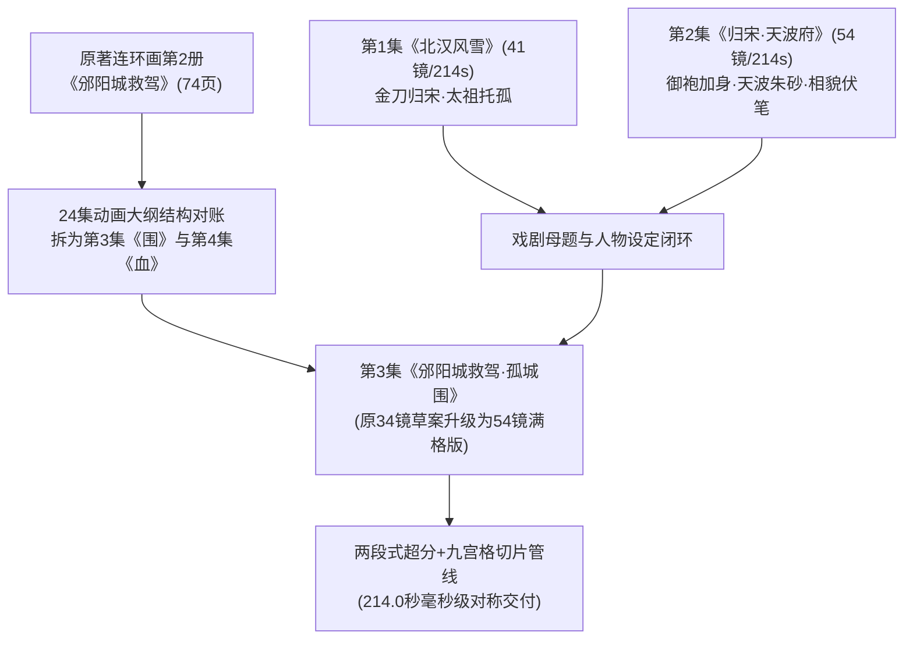

# 《北宋杨家将》第 3 集《邠阳城救驾》剧本对账分析与全案策划思考录

> **项目名称**：《北宋杨家将》系列水墨剪纸国风 AI 动画短剧  
> **剧集信息**：第 3 集《邠阳城救驾》（别名《邠阳 · 孤城围》）  
> **制作标准**：6 组九宫格满格版 · 全 54 镜高密度电影级剪辑 · 214.0 秒对称时长 · 9:16 竖屏新白描美学  
> **文档性质**：剧本大纲深度对账报告、戏剧母题前后呼应架构、美学与工程思考沉淀  
> **创建日期**：2026-10-08  

---

## 一、 核心对账总述（三大维度深度对账）

根据制作总监指令，在开启第 3 集剧本精修与分镜切分之前，必须进行全面、严密的**多维对账**。本剧作为 24 集宏大史诗竖屏动画短剧的核心承转节点，必须在“原著连环画源头”、“24 集短剧改编总大纲”以及“第 1、2 集已交付资产与视听工程”之间实现无缝咬合与严密闭环。



---

### 1. 维度一：原著连环画 vs 24集动画大纲对账

| 对账项 | 湖南美术出版社原著连环画（蒋太禄等绘） | 24集竖屏动画改编总大纲规划 | 第 3 集最终落地工程版定位 | 对账决策与思考依据 |
| :--- | :--- | :--- | :--- | :--- |
| **册目与集数映射** | **第 2 册全册**：《邠阳城救驾》（共 74 页图文） | **拆分为两集**：<br>• 第 3 集《邠阳城 · 围》（1~37页）<br>• 第 4 集《邠阳城 · 血》（38~74页） | **第 3 集《邠阳城救驾》**<br>*(孤城受困 · 提兵赴难)*<br>承载原书 1~37 页完整戏剧弧光 | **体量与节奏承载力对账**：连环画第 2 册 74 页信息量极其巨大（五台还愿、萧太后起兵、韩延寿伏击、大郎突围、杨业提兵、辽军诱敌让路、大郎换御袍代降、双龙会血战、七子去六子回）。单集 210~214 秒绝对无法容纳 74 页；若强行塞入，人物情绪与武戏节奏将彻底崩塌。因此，按大纲科学划分为两集，第 3 集专门聚焦“孤城合围、提兵救驾、步入死局”的压迫感建立！ |
| **开场情境** | 太宗即位，感念神恩，欲幸五台山还愿；寇准力谏不听，封杨延平为护驾大将军。 | 汴京朝堂起驾，直赴五台山；佛殿进香埋下宿命因果。 | 紧密承接第 2 集天波府落成，开篇用“赭黄龙旗在边关朔风中猎猎撕扯”作为抓人钩子，迅速引出五台还愿。 | **视觉钩子对账**：竖屏短剧讲究前 3 秒留存，不能平铺直叙。将“五台山月白冷雾”与“朝堂寇准苦谏”熔铸为动静相兼的叙事发端。 |
| **核心戏剧冲突** | 辽国大举设伏合围邠阳城；延平突围求援；杨业率部救驾入城；太宗犹豫次日再撤。 | 邠阳城被困，辽兵水泄不通；杨延平突出重围赴代州；杨业提兵急进；辽兵诡计让路入城；太宗滞留。 | 扩充为五幕完整剧作结构：<br>1. 盛极隐忧 · 五台还愿<br>2. 幽州暗伏 · 诱敌深入<br>3. 孤城合围 · 铁锁大闭<br>4. 箭创敌首 · 决死突围<br>5. 代州警报 · 金刀赴难<br>6. 阴谋让路 · 绝地死局 | **戏剧冲突纵深对账**：原画连环画中大郎突围与杨业入城较平缓，剧本必须强化“辽军围而不歼、故意放杨家将进城合围”的毒计阴谋，使观众在杨业父子进城的一刻产生巨大的惊悚感与悲剧窒息感。 |

---

### 2. 维度二：前后剧集脉络呼应与角色设定对账

剧本绝不能孤立存在，必须与已全链路交付的第 1、2 集严丝合缝，并为后续核心高潮（第 4 集血战、第 6 集李陵碑、第 24 集挂帅）埋下深邃伏笔：

```text
第 1 集《北汉风雪》 ──> 第 2 集《归宋 · 天波府》 ──> 第 3 集《邠阳城救驾》 ──> 第 4 集《邠阳城 · 血》 ──> 第 6 集《李陵碑 · 殉国》
【金刀与风雪】         【御袍加身与相貌伏笔】     【龙袍同框与孤城落锁】     【换袍代降与长子折戟】     【万箭钻心与白发撞碑】
```

#### （1）“御袍与面貌相类”的致命伏笔（C03 杨延平 vs C13 宋太宗）
- **前作呼应**：在第 2 集 Shot 46 中，宋太宗亲解御袍覆于杨业肩头；在 Shot 47 与 50 中，大郎杨延平神采沉稳受封，人物设计库中明确规定 `C03 杨延平与 C13 宋太宗容貌相类，大郎更清瘦英挺，太宗略富态`。
- **本集呼应**：第 3 集开篇，太宗亲封延平为“护驾大将军”，并同立御辇两侧；在邠阳城危急关头，二人同登城楼远眺，视觉上的“神似”再次被摄像机反复强调。
- **后续兑现**：正是这一无可辩驳的视觉神似，成为了第 4 集《邠阳城 · 血》中“大郎延平主动请缨，脱下太宗御袍换穿己身，替帝赴死，金沙滩伪降”的**唯一合理逻辑支点**！

#### （2）“城门”核心母题的命运反转（S02 / S06 场景意象）
- **第 2 集**：Shot 38 应州城隘“巨型铁锁褪下，应州关隘大门轰然大开，金光照耀”，象征弃暗投明，走向繁华太平；
- **第 3 集**：Shot 22 邠阳城关“巨型城门轰然合拢，重铁门闩沉闷下落，铁锁咔哒扣死”，四周辽军万点火把连成死网！门“开”与门“闭”，两集形成极其震撼的宿命对仗。

#### （3）“七郎性情与万箭暗谶”的延展（C08 杨延嗣）
- **前作呼应**：第 2 集 Act II 七郎延嗣夜劫空营险遭万弩攒射，杨业怒杖四十并立下谶语：“为将不知深浅，他日沙场必遭万箭钻心之祸！”
- **本集表现**：第 3 集 Act V 代州惊闻兄长重伤求援，七郎再次怒发冲冠、按刀求战，虽被父亲按住阵脚，但其烈火性格始终如一，与六郎延昭的冷静深谋形成鲜明对比。

#### （4）“五台山佛缘与五郎落发”的伏脉千里（S05 / C07）
- **本集引入**：第 3 集太宗前往五台山佛殿还愿，在释迦牟尼佛像前俯首叩拜（全剧太宗唯一一次下跪），青松古刹，香烟袅袅；
- **后续闭环**：第 4 集乱军大战中，五郎延德目睹三兄惨死、朝政昏愦，掏出母亲临行交付的剃刀与度牒，在荒墙下断发投奔五台山；第 7 集六郎收尸路过五台山与化为僧形的五郎重逢，完成佛缘闭环。

---

### 3. 维度三：工程规格对账（从 34 镜粗糙草案升级至 54 镜满格工程版）

| 视听技术指标 | 原 34 镜大纲草案 | 新版 54 镜满格工程版 | 优化决策与工业考量 |
| :--- | :---: | :---: | :--- |
| **总镜头数量** | 34 镜 | **54 镜（整整 6 组九宫格）** | **原画额度 100% 榨干**：Gemini 单次生成 3×3 九宫格原画。原 34 镜方案需消耗 4~5 次额度但存在大量空格废格。升级为 54 镜后，以 6 次生图额度产出 54 个无损切片首帧，零浪费！ |
| **总成片时长** | 210.0 秒（3分30秒） | **214.0 秒（3分34秒）** | **严格时序对称**：与第 1 集（214.0s）及第 2 集（214.0s）完全保持毫秒级一致，构建广播级短剧系列严谨的篇幅韵律。 |
| **单镜平均时长** | 6.18 秒 | **3.96 秒** | **电影级黄金剪辑律动**：原案 6~8 秒镜头过多，动作场面容易发飘停滞。54 镜方案中，武打交锋与突围采用 2~3 秒凌厉快切与留白爆闪，文戏与城楼对弈保留 5~7 秒沉淀，张弛有度。 |
| **运镜语法标准** | 含有 2 处横屏平摇 | **100% 竖屏 9:16 语法重构** | 严格贯彻《竖屏规格书》：上 1/3 留白与远山、中 1/3 人物与叙事、下 1/3 地面与落点；彻底消除横向平摇，全部重构为纵深推进、高角度纵深俯拍与竖移。 |
| **工作流超分架构** | 未定义 | **两段式安全超分管线** | 阶段一：MiniMax H3 原生 544×960 Turbo 极速扩散（显存稳定 13.8GB，零 OOM 风险）；<br>阶段二：RealESRGAN 分块超分至 720P/1080P，白描墨线硬化，剥离噪声。 |
| **声音系统设计** | 仅单条旁白说明 | **三轨母带级声学建模** | Edge-TTS `zh-CN-YunjianNeural` 沧桑正剧男声绝对长轴排布；全频段古风民乐（牛皮战鼓、塞外号角、羽调式古埙、皇朝大磬）；54 镜精确音效卡点与智能侧链闪避。 |

---

## 二、 角色、道具与场景资产对账总表

为了保证 ComfyUI H3 图生视频首帧生成与九宫格提示词的人物一致性，本集严格继承并锁定以下资产：

### 1. 核心出场角色资产规范

| 角色编号 | 角色名称 | 阵营与身份 | 色盘与服饰纹样 | 核心视觉特征与动作体态 | 本集关键戏剧动作 |
| :---: | :---: | :---: | :---: | :---: | :---: |
| **C03** | **杨延平（大郎）** | 大宋 · 护驾大将军 | **月白战袍** + 银甲 + 云纹披风 | 面容沉毅英朗，与宋太宗面容神态高度相类，佩长剑与精钢银枪。 | 殿前领兵、五台随侍、阵斩耶律奇、一箭射穿韩延寿左臂、突围重伤赴代州报捷。 |
| **C13** | **宋太宗（赵光义）** | 大宋 · 皇帝 | **赭黄龙袍** + 鎏金铠 + 团龙纹 | 头戴平天冠，面容与大郎相类但面带富态、双眼微狭。喜怒不形于色，遇险易疑。 | 执意幸五台山、佛前下拜还愿、邠阳城头按垛发抖、犹豫迟疑错失撤离良机。 |
| **C01** | **杨 业（杨令公）** | 大宋 · 边关主帅 | **熟铜甲** + 墨黑披风 + 金刀 | 须发微霜，双目如电，面如重枣，身形如渊渟岳峙。手按卷刃金刀。 | 代州按兵、闻警惊起、点齐六子与三万轻骑星夜驰援、城头远眺叹息死局。 |
| **C08** | **杨延嗣（七郎）** | 大宋 · 少将 | **火红战袍** + 熟铜软甲 | 剑眉星目，体格矫健，腰悬双鞭，满身少年豪迈杀气。 | 闻兄重伤暴怒求战，随父突入邠阳重围，阵前斩将。 |
| **C07** | **杨延昭（六郎）** | 大宋 · 诸子中坚 | **白袍** + 素银鳞甲 + 虎头枪 | 目光沉稳睿智，举止从容，兼具儒将气质。 | 护卫中军，察觉辽军“让路”异样，谏劝父亲多加提防。 |
| **C15** | **萧太后（萧绰）** | 大辽 · 摄政太后 | **玄黑貂裘** + 金凤冠 + 珠络 | 容貌威严冷艳，眼神深不可测，指间常拨动象牙算筹。 | 幽州行宫定计，命韩延寿统兵五万诱宋主入伏。 |
| **C16** | **韩延寿** | 大辽 · 兵马大元帅 | **铁青狼头铠** + 灰黑狼皮大氅 | 满面虬髯，身形魁伟如熊，手使沉重开山大槊。 | 领大军合围邠阳城，被延平神箭射中左臂落马，后指挥万军封死城关。 |
| **C17** | **耶律奇** | 大辽 · 先锋猛将 | **青铜叶子甲** + 赭石风帽 | 悍勇残忍，双目暴突，手持九环大砍刀。 | 城外伏击前锋，与杨延平走马交锋数十合，被挑落马下。 |

### 2. 关键道具流变追踪表

| 道具编号 | 道具名称 | 视觉表现 | 戏剧隐喻与全片流变线 |
| :---: | :---: | :---: | :---: |
| **P03** | **延平的佩剑** | 素银吞口、墨色鲨鱼皮鞘、白丝剑穗 | **长子的代位与绝唱**：本集佩于延平腰间 → 第 4 集战前解剑留营托付六郎 → 第 8 集摆在佘太君案前哭灵 → 第 24 集立于穆桂英帅案！ |
| **P01** | **杨业的金刀** | 刀身沉重厚实，刃口微有宿战旧痕，墨色柄缠金丝 | **家国孤忠的镇石**：代州闻警拔刀出鞘一寸，冷光映照老将双眸；邠阳城头按刀远眺。 |
| **P07** | **萧太后的象牙算筹** | 洁白象牙长算筹，泛着冷润光泽 | **命运的精密绞杀**：太后指间排开算筹，每落一筹即代表数万大军合围一步。 |
| **P08** | **带血的告急诏书** | 赭黄绫绢被鲜血渗透浸黑，边缘磨损碎裂 | **危局凭证**：大郎身中数创自邠阳带出，血滴滴落代州帅案。 |

### 3. 核心场景空间规划（S05 / S06 / S07）

```text
【S05 五台山佛殿】（Act I）
• 视觉：月白雾气、百尺冷杉青松、古铜释迦牟尼巨佛、青烟缕缕、石阶留白。
• 氛围：空灵、静穆、佛理禅意，与随后扑面而来的杀伐血腥形成极度冷酷的对冲。

【S07 幽州辽营大帐】（Act II）
• 视觉：巨幅玄黑大旗、狼首图腾、鎏金酒樽、帐外猎猎朔风。
• 氛围：阴鸷、压抑、雷霆待发，象牙算筹敲击金案的清脆冷响。

【S06 邠阳城与内外死地】（Act III ~ VI）
• 视觉：青灰巨石砌筑的高峻孤城，城头垛口旗帜破损；城外漫山遍野枯草覆霜；
  四面八方数万辽军火把如密密麻麻的火蛇缠绕。
• 氛围：绝望、窒息、铁锁紧扣、瓮中捉鳖。
```

---

## 三、 视听美学与工程纪律（朱砂纪律与声学卡点）

### 1. 严格践行“上美影水墨剪纸”设色与朱砂纪律
- **底色调**：全片恪守低饱和矿物颜料设色——青瓷绿、赭石、铁灰、墨黑、月白。严禁出现西式 3D 渲染光影与塑料反光。
- **朱砂纪律（极度吝啬）**：
  - 整部第 3 集中，全片前 53 镜**严禁大面积朱砂泛滥**！
  - 仅允许在延平突围受创时，箭创崩裂的甲片缝隙中渗出极其克制的暗朱砂点；
  - **Shot 54（终局压轴）**：镜头自杨业独立城楼缓缓拉开，城外千万支辽军火把在黑夜中化作无数跳动的**朱砂赤火**，彻底合拢包围圈，大磬轰鸣，定格淡出！

### 2. 声音工程：沧桑旁白长轴与全频民乐物理建模
- **旁白排布**：微软 Edge-TTS `zh-CN-YunjianNeural`（参数：`rate="-3%", pitch="-2Hz"`），入画 0.35s 进声，句尾留白 0.40s，自然跨镜流淌。
- **全频民乐乐器编排**：
  - 佛殿还愿：古磬清鸣、空灵古琴散音；
  - 辽帐谋算：低沉管乐、象牙撞击、塞外长号引颈长啸；
  - 邠阳大战：八面牛皮战鼓连续重击（55Hz 极低频下潜）、钢枪破空啸叫、神臂弩机括紧绷；
  - 城门合锁：重型大铜门滚轮轰鸣、铁锁咔哒落锁重击（HIT 震动）；
  - 终局死战：羽调式埙箫哀鸣，金石大磬悲怆轰响。
- **动态侧链闪避**：旁白播报时，BGM 200~3000Hz 频段深凹闪避 -14dB，鼓点减弱 -6dB，确保台词字字清晰入耳。

---

*策划报告完结。本对账方案已作为核心依据，全面指导《第 3 集 54 镜分镜头脚本总表》与《九宫格原画提示词指南》的精确编制。*
