# ComfyUI Automations 定时任务迁移指南与资料包

本目录汇集了原 Antigravity "Automations" 模块中 3 个定时任务的全部配置、执行脚本、外部 Agent 接入桥接服务及迁移实操方案，供后续在其他 AI Agent 工具、自动化编排平台或新会话中开箱即用。

---

## 一、 目录资料索引

```text
docs/automations_migration/
├── README.md                              <-- 本文档（全套迁移指南与操作规范）
├── sidecars_backup/                       <-- 原 Antigravity Automations 配置原始备份
│   ├── hourly-asian-female-character.json
│   ├── hourly-asian-female-character-flow-image.json
│   └── hourly-standalone-garment.json
└── scripts/                               <-- 迁移与跨工具对接脚本库
    ├── run_character_task.bat             <-- [CLI/系统] 角色任务一键运行脚本（带错误码）
    ├── run_garment_task.bat               <-- [CLI/系统] 服装任务一键运行脚本（带错误码）
    ├── agent_api_bridge.py                <-- [Dify/n8n/Coze] 本地 HTTP Webhook 桥接服务 (Port 8095)
    ├── start_agent_bridge.bat             <-- 一键拉起 Agent HTTP 桥接服务
    └── windows_task_scheduler_setup.ps1   <-- [Windows] 一键注册系统级任务计划程序
```

此外，项目根目录已备有原生常驻调度文件：
- `tools/hourly_scheduler.py`：Python 本地常驻防风控轮询调度器（含静默冷却逻辑）。
- `start_hourly_scheduler.bat`：双击直接拉起本地常驻调度器。

---

## 二、 原 3 个定时任务档案与底层逻辑

### 1. 任务档案对照

| 任务名称 (Display Name) | 原 Cron 计划 | 核心执行命令 | 产物去向 | 现状解析 |
| :--- | :--- | :--- | :--- | :--- |
| **Hourly Asian Female Character Generator** | `0,30 * * * *`<br>(每小时 00, 30分) | `cmd /c D:\ai_projects\ComfyUI\venv\Scripts\python.exe tools/hourly_character_task.py --count 1` | `output/YYYY-MM-DD/characters/`<br>`character_library/`<br>`assets.db` | 核心角色生成任务：每次连续请求 Google Flow 9次渲染 9 独立高清视角，RetinaFace+InsightFace 提取人脸特征入库。 |
| **Hourly Asian Female Character Generator (Google Flow Image)** | `0,30 * * * *`<br>(每小时 00, 30分) | `cmd /c D:\ai_projects\ComfyUI\venv\Scripts\python.exe tools/hourly_character_task.py --count 1` | 同上 | **冗余任务**。系之前调试 `google-flow-image` 技能时创建的副本，执行逻辑与任务 1 100% 相同。**迁移时合并为一个任务即可**。 |
| **Hourly Standalone Garment Generator** | `15,45 * * * *`<br>(每小时 15, 45分) | `cmd /c D:\ai_projects\ComfyUI\venv\Scripts\python.exe tools/hourly_garment_task.py --count 1` | `output/YYYY-MM-DD/wardrobe/`<br>`garment_library/`<br>`assets.db` | 核心服装生成任务：生成单件幽灵假人服装，rembg 去底生成透明图/白底图/缩略图，计算主色调入库。 |

### 2. 调度执行时序规范（错峰机制）

```mermaid
gantt
    title 每小时任务错峰执行节奏 (防风控与资源独占)
    dateFormat mm
    axisFormat %M分
    section 角色生成
    00分批次 :active, char1, 00, 08m
    30分批次 :active, char2, 30, 38m
    section 服装生成
    15分批次 :crit, garm1, 15, 20m
    45分批次 :crit, garm2, 45, 50m
    section 静默安全期
    冷却间隙 :done, cool1, 08, 15m
    冷却间隙 :done, cool2, 20, 30m
    冷却间隙 :done, cool3, 38, 45m
    冷却间隙 :done, cool4, 50, 60m
```


---

## 三、 环境前置与基础设施依赖

无论迁移到哪类 AI Agent 工具，底层环境必须满足以下要求：

1. **Python 解释器环境**：
   - 必须使用指定 venv：`D:\ai_projects\ComfyUI\venv\Scripts\python.exe`
   - 不可使用全局 Python，否则将缺失 `insightface`、`rembg`、`onnxruntime` 等核心依赖。
2. **工作目录 (Working Directory)**：
   - 必须严格锁定在：`D:\ai_projects\ComfyUI`。
3. **网络代理要求**：
   - 本机翻墙客户端需保持常开，且本地 HTTP 代理端口必须为 `http://127.0.0.1:7897`（脚本内已硬编码指定给 Chrome 实例）。
4. **Chrome 浏览器与 CDP 端口**：
   - Chrome 安装路径需为 `C:\Program Files\Google\Chrome\Application\chrome.exe`。
   - 脚本支持自动检测并拉起独立配置目录 `flow_chrome_profile` 并占用 `9222` 端口。
5. **执行超时阈值设置**：
   - 单次角色任务（9 个连续视角）耗时约 3~8 分钟。
   - 在新 Agent 工具或计划任务中，务必将超时时间（Timeout）设置为 **15 分钟以上**，切勿设置过短导致进程被掐断。

---

## 四、 跨平台迁移与接入方案

### 方案 A：接入开源可视化 Agent 平台（Dify / n8n / FastGPT / Coze）

适用场景：需要 Web 仪表盘监控、执行记录审计、飞书/微信群告警通知。

#### 步骤 1：启动本地 Agent HTTP 桥接服务
运行 `docs\automations_migration\scripts\start_agent_bridge.bat`，服务将在本地 `http://127.0.0.1:8095` 启动。

#### 步骤 2：平台配置 Webhook 节点
- **角色生成触发**：
  - URL: `http://127.0.0.1:8095/tasks/character`
  - Method: `POST`
  - Body (JSON): `{"count": 1, "async": false}`
- **服装生成触发**：
  - URL: `http://127.0.0.1:8095/tasks/garment`
  - Method: `POST`
  - Body (JSON): `{"count": 1, "async": false}`
- **定时触发设置**：
  - 在 n8n 中添加 `Schedule Trigger`，设置 Cron 表达式：
    - 角色任务：`0,30 * * * *`
    - 服装任务：`15,45 * * * *`

---

### 方案 B：接入命令行/自主编码 Agent（Claude Code / OpenHands / Aider）

适用场景：希望保持类似当前 Antigravity 的高智能自主性（Agent 自行执行命令、自检输出、报错时自动分析日志修复代码）。

#### 方式：通过系统调度器拉起 Agent CLI
使用 Windows 任务计划程序或脚本定期运行 Agent 非交互模式（Headless）：

```bat
REM 角色生成与 Agent 质检
cmd /c claude -p "在工作目录 D:\ai_projects\ComfyUI 下执行: D:\ai_projects\ComfyUI\venv\Scripts\python.exe tools/hourly_character_task.py --count 1。执行完成后读取 character_library/index.json 验证是否有新角色入库，若有异常请检查 Chrome 9222 状态并给出诊断报告。"
```

---

### 方案 C：接入代码级 Multi-Agent 框架（CrewAI / LangGraph / AutoGen）

适用场景：自定义 Python 多智能体协同流水线。

将包装好的脚本作为工具（Tool）注入 Agent：

```python
from langchain.tools import tool
import subprocess

@tool
def generate_asian_female_character() -> str:
    """生成一位包含9大视角的亚洲女性角色资产并入库"""
    res = subprocess.run(
        [r"D:\ai_projects\ComfyUI\venv\Scripts\python.exe", "tools/hourly_character_task.py", "--count", "1"],
        cwd=r"D:\ai_projects\ComfyUI", capture_output=True, text=True, encoding="utf-8"
    )
    return res.stdout if res.returncode == 0 else f"Fail: {res.stderr}"

@tool
def generate_standalone_garment() -> str:
    """生成一款独立服装资产并去底入库"""
    res = subprocess.run(
        [r"D:\ai_projects\ComfyUI\venv\Scripts\python.exe", "tools/hourly_garment_task.py", "--count", "1"],
        cwd=r"D:\ai_projects\ComfyUI", capture_output=True, text=True, encoding="utf-8"
    )
    return res.stdout if res.returncode == 0 else f"Fail: {res.stderr}"
```

---

### 方案 D：生产级系统直驱（Windows 任务计划程序 - 零额外 Token 消耗）

适用场景：生产环境 7x24 小时低成本、极高稳定性运行。由于两个 Python 脚本本身已包含完整的全链路闭环，直接系统定时调度是最优解。

#### 快速部署方法：
以普通用户或管理员身份在 PowerShell 中执行：
```powershell
powershell -ExecutionPolicy Bypass -File "D:\ai_projects\ComfyUI\docs\automations_migration\scripts\windows_task_scheduler_setup.ps1"
```
执行后，Windows 任务计划程序（`taskschd.msc`）中将自动生成：
- `ComfyUI_Hourly_Character_Task`（每 30 分钟）
- `ComfyUI_Hourly_Garment_Task`（每 30 分钟，错峰 15 分钟）

---

## 五、 常见故障排查手册 (FAQ)

1. **Q: 提示 Chrome 9222 连接失败或未登录？**
   - **排查**：检查进程管理器中是否已有卡死的 Chrome 实例占用了 9222 端口。
   - **解决**：在终端执行 `cmd /c taskkill /F /IM chrome.exe`，然后手动运行一次脚本，让其自动初始化 Profile 并登录 Google 账号。
2. **Q: 生成图片变慢或被 Google Flow 限制？**
   - **排查**：脚本严格设置了 11~14 分钟冷却期，切勿将两个任务的并发数设为大于 1，亦不可频繁手动连击。
3. **Q: 生成的图片存储在哪里？**
   - 遵循项目规则统一归档在按当日日期命名的目录：
     - 角色：`output/YYYY-MM-DD/characters/<char_id>/`
     - 服装：`output/YYYY-MM-DD/wardrobe/standalone_items/`
     - 资产索引元数据：`character_library/index.json`、`garment_library/index.json` 及 SQLite `assets.db`。
