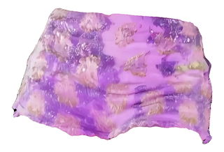
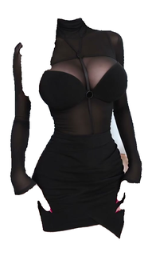
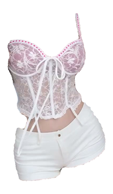
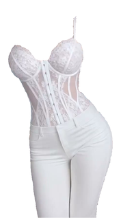
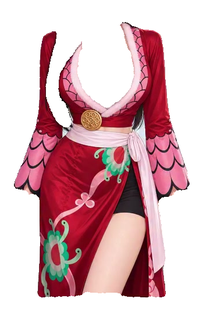
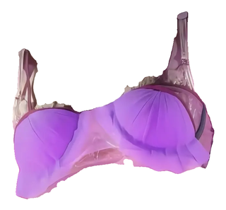

# 服装库清单 · garment_library

> 自动生成，请勿手改；重跑 `python tools/garment_extract/library_build_index.py` 刷新。  共 **6** 件，更新于 2026-10-12 17:07


## 一、总表

| # | garment_id | 类别 | 主色 | 尺寸 | 掩码面积 | 版本 | 方法 | 来源标签 | 库内路径 |
|---|---|---|---|---|---|---|---|---|---|
| 1 | `top_20261012_01` | 上装 | <span style="color:#af70c0">■</span> `#af70c0` | 710×659 | 172,565 | 1 | sam2_box | 7686812393779123898_01 | `tops/top_20261012_01` |
| 2 | `btm_20261012_01` | 下装 | <span style="color:#c489c5">■</span> `#c489c5` | 868×591 | 312,292 | 1 | sam2_box | 7686812393779123898_01 | `bottoms/btm_20261012_01` |
| 3 | `full_20261012_01` | 整套 | <span style="color:#232021">■</span> `#232021` | 518×870 | 219,556 | 3 | atr+sam2 | DeGg3wkgn4p_1 | `full/full_20261012_01` |
| 4 | `full_20261012_02` | 整套 | <span style="color:#d0c9cd">■</span> `#d0c9cd` | 427×733 | 138,468 | 3 | atr+sam2 | DeJu0mmA4jW_1 | `full/full_20261012_02` |
| 5 | `full_20261012_03` | 整套 | <span style="color:#d1d0d5">■</span> `#d1d0d5` | 495×893 | 198,706 | 3 | atr+sam2 | DeMaIN9gB3Q_1 | `full/full_20261012_03` |
| 6 | `full_20261012_04` | 整套 | <span style="color:#a95765">■</span> `#a95765` | 349×551 | 89,752 | 3 | atr+sam2 | DeRjgPHgZAK_1 | `full/full_20261012_04` |

## 二、缩略图墙


### 下装（bottoms/，共 1 件）

**`btm_20261012_01`** · #c489c5 · 868×591 · 7686812393779123898_01 [https://www.douyin.com/note/7686812393779123898](https://www.douyin.com/note/7686812393779123898)



> 紫色荷叶边文胸上衣+紫色亮片印花迷你短裙；来源：抖音图文笔记图1；ATR+SAM2(CPU,box提示)提取


### 整套（full/，共 4 件）

**`full_20261012_01`** · #232021 · 518×870 · DeGg3wkgn4p_1



> 抖音参考视频整套穿搭：ATR+SAM2 提取，rank1 为最佳帧，rank2/3 为备选帧版本

**`full_20261012_02`** · #d0c9cd · 427×733 · DeJu0mmA4jW_1



> 抖音参考视频整套穿搭：ATR+SAM2 提取，rank1 为最佳帧，rank2/3 为备选帧版本

**`full_20261012_03`** · #d1d0d5 · 495×893 · DeMaIN9gB3Q_1



> 抖音参考视频整套穿搭：ATR+SAM2 提取，rank1 为最佳帧，rank2/3 为备选帧版本

**`full_20261012_04`** · #a95765 · 349×551 · DeRjgPHgZAK_1



> 抖音参考视频整套穿搭：ATR+SAM2 提取，rank1 为最佳帧，rank2/3 为备选帧版本


### 上装（tops/，共 1 件）

**`top_20261012_01`** · #af70c0 · 710×659 · 7686812393779123898_01 [https://www.douyin.com/note/7686812393779123898](https://www.douyin.com/note/7686812393779123898)



> 紫色荷叶边文胸上衣+紫色亮片印花迷你短裙；来源：抖音图文笔记图1；ATR+SAM2(CPU,box提示)提取


## 三、文件结构

```
garment_library/
├── index.json     机读索引（脚本/工作流读这个）
├── INDEX.md       本清单（人读）
├── index.html     可视化目录（双击打开，可筛选/复制路径）
├── tops/ bottoms/ full/   每件一个子目录
│   └── <garment_id>/{transparent.png, white.png, thumb.png, meta.json, alts/}
└── sources/       原始参考图存档
```


## 四、常用命令

```bash
# 单图提取（人工框更稳）：
python tools/garment_extract/extract_from_image.py <图片> <运行目录> [--boxes top=x0,y0,x1,y1]
python tools/garment_extract/library_add.py <运行目录> --source-url ... --note ...

# 既有产物批量入库（extract_garment.py 的视频产物）：
python tools/garment_extract/library_import.py output/2026-10-11/garment_extract --category full

# 刷新本清单与 HTML 目录：
python tools/garment_extract/library_build_index.py
```
